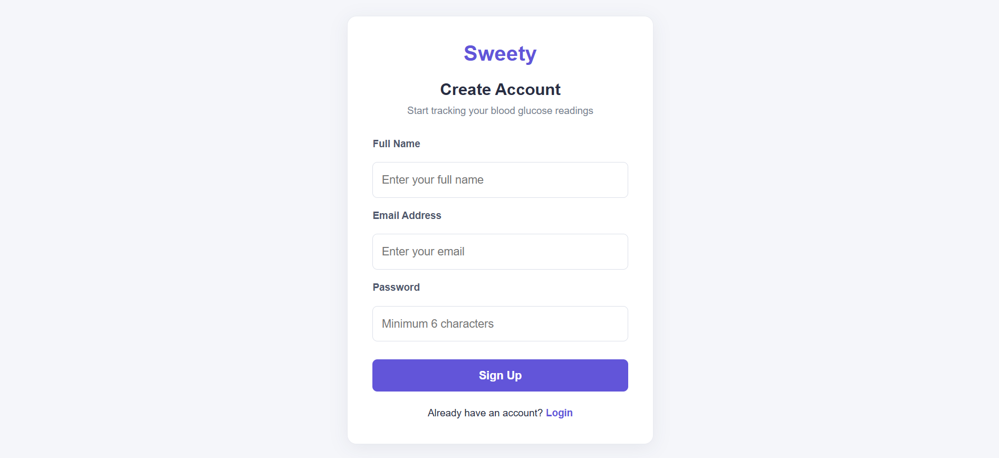
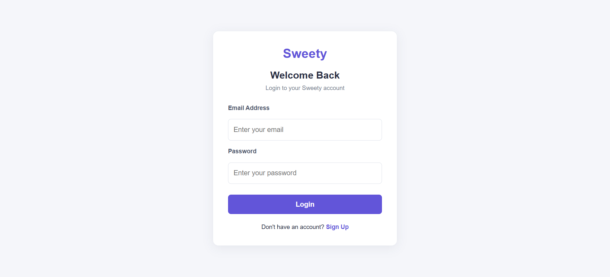
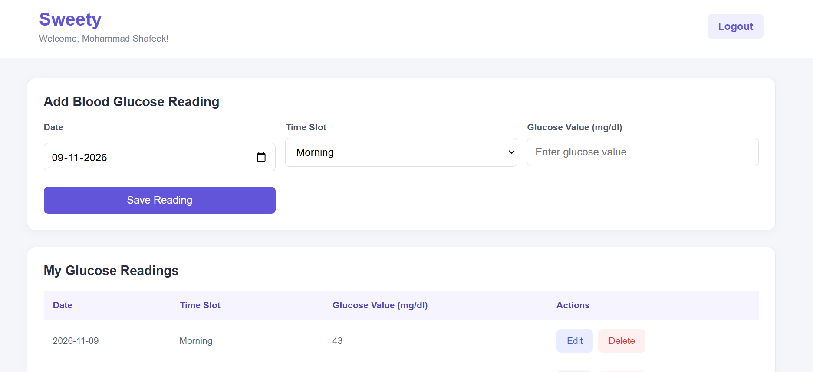
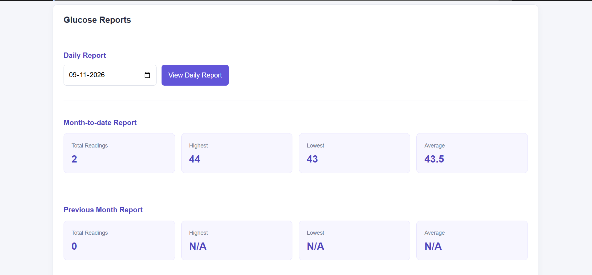

# Sweety – Blood Glucose Tracker

Sweety is a web-based blood glucose tracking application that helps users record, manage, and monitor their glucose readings through a simple and user-friendly dashboard.

## Features

- User Registration and Login
- Secure Authentication using JWT
- Password Hashing using bcrypt
- Add, View, Edit, and Delete Glucose Readings
- Daily Glucose Reports
- Monthly Glucose Reports
- Previous Month Reports
- User-specific Reading Management
- Reading Validation
- Responsive User Interface

## Screenshots

### Register


### Login


### Dashboard


### Reports


## Tech Stack

**Frontend**
- React.js
- JavaScript
- HTML5
- CSS3
- Vite

**Backend**
- Node.js
- Express.js
- REST APIs
- JWT Authentication
- bcrypt

**Database**
- PostgreSQL

**Tools**
- Git and GitHub
- Postman
- VS Code

## Project Structure

```text
Sweety/
├── client/
│   └── React Frontend
├── server/
│   └── Express Backend
├── screenshots/
├── .gitignore
└── README.md
```

## Getting Started

### 1. Clone the Repository

```bash
git clone https://github.com/MohammadShafeek/Sweety-Blood-Glucose-Tracker.git
cd Sweety-Blood-Glucose-Tracker
```

### 2. Setup Backend

```bash
cd server
npm install
```

Create a `.env` file inside the `server` folder using `.env.example`.

Configure your PostgreSQL credentials and JWT secret:

```env
PORT=5000
DB_HOST=localhost
DB_PORT=5432
DB_NAME=sweety_db
DB_USER=postgres
DB_PASSWORD=your_database_password
JWT_SECRET=your_secret_key
```

### 3. Setup Database

- Make sure PostgreSQL is installed and running.
- Create a database named `sweety_db`.
- Ensure the required database tables are created using the project's database schema.

### 4. Seed Demo Data

Run the following command from the `server` folder:

```bash
npm run seed
```

This creates a demo user and sample glucose readings.

**Demo Login Credentials**

- Email: `demo@sweety.com`
- Password: `Demo@123`

### 5. Start Backend

Run from the `server` folder:

```bash
npm run dev
```

The backend will run on:

`http://localhost:5000`

### 6. Setup Frontend

Open another terminal:

```bash
cd client
npm install
npm run dev
```

Open the local URL displayed by Vite in your browser.

## Validation and Testing

The following application scenarios can be tested manually:

- Register a new user and log in.
- Add a glucose reading.
- Edit and delete an existing reading.
- Verify that empty glucose values are rejected.
- Verify that only whole-number values between 40 and 600 mg/dl are accepted.
- Verify that duplicate readings for the same date and time slot are rejected.
- Verify that a maximum of four readings can be added per day.
- Verify that future dates cannot be selected.
- Check daily, monthly, and previous-month reports.
- Verify that users can access only their own readings.

## Security

- Passwords are hashed using bcrypt.
- Protected API routes use JWT authentication.
- User-specific reading access is enforced through authenticated user IDs.
- Environment variables are excluded from version control.

## Notes

- This project was developed as part of the Junior Full Stack Developer assignment.
- The application uses PostgreSQL for persistent data storage.
- Demo data can be generated using the seed script.
- Create your own `.env` file before running the application.
- Never commit real environment variables or database credentials to GitHub.

## Author

**Mohammad Shafeek**

- GitHub: https://github.com/MohammadShafeek
- LinkedIn: https://www.linkedin.com/in/mohammad-shafeek-b74124339/
